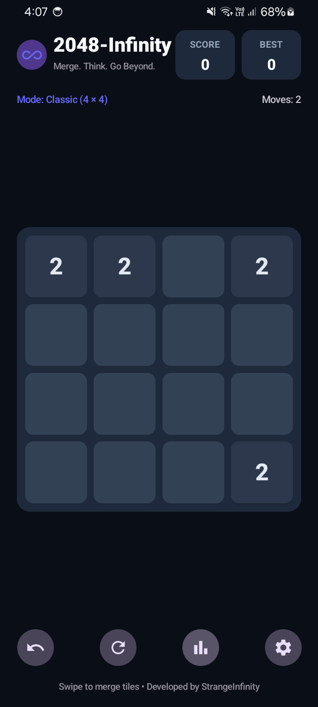
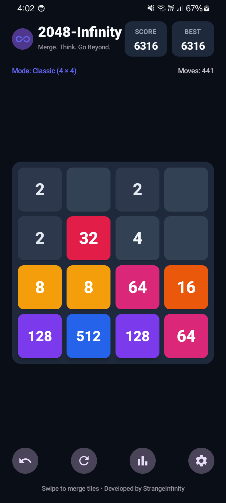
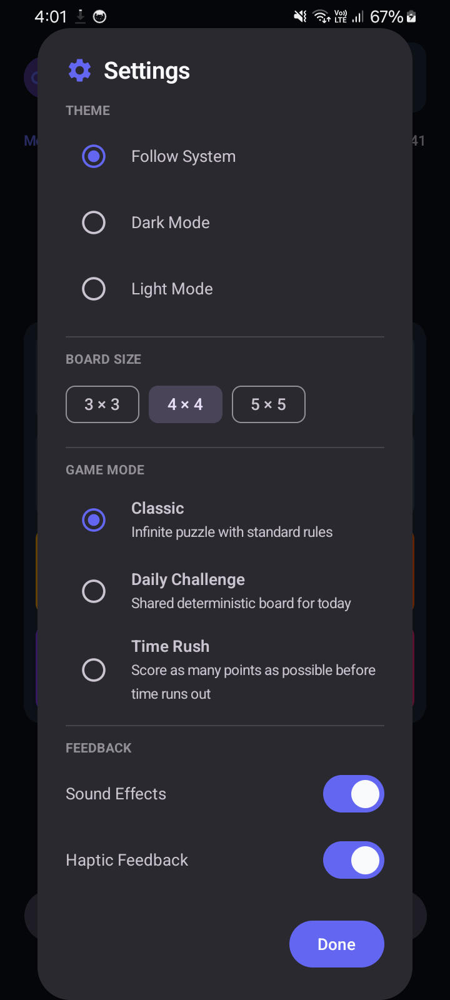
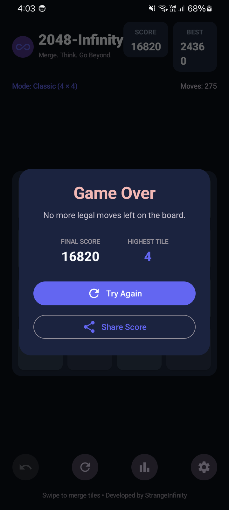
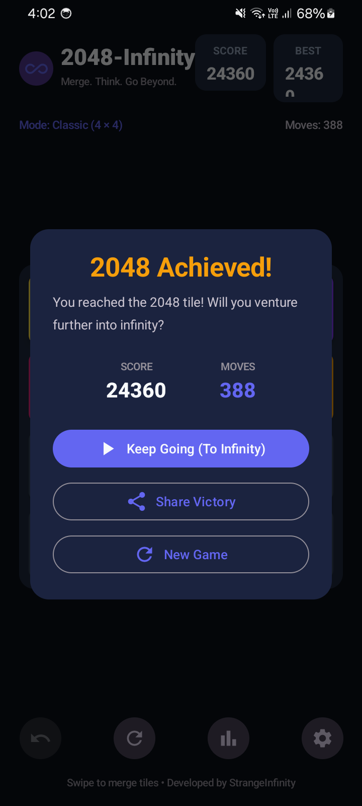

# 2048-Infinity

> **Merge. Think. Go Beyond.**  
> An original native Android puzzle game developed by **StrangeInfinity**.

---

## Overview

**2048-Infinity** is a modern, high-performance native Android puzzle game built from the ground up with Kotlin and Jetpack Compose. Inspired by the classic sliding-tile mathematical puzzle, 2048-Infinity elevates the experience with an infinity-inspired aesthetic, ultra-fluid animations running at native display refresh rates, persistent local progress, rich player statistics, deterministic challenges, and full offline privacy.

Developed under the **StrangeInfinity** brand, 2048-Infinity is 100% self-contained: no advertisements, no tracking, no account creation, and zero network permissions.

---

## Genuine Device Screenshots

*Captured directly from a connected Samsung Galaxy M04 (SM-E045F) running Android 14 (API 34) via ADB.*

| Gameplay (Active Board) | Merging Tiles & High Values | Dark Theme |
| :---: | :---: | :---: |
|  |  |  |

| Game Settings | Game Over Overlay | Victory (2048 Achieved) |
| :---: | :---: | :---: |
|  |  |  |

---

## Features

- **Pure Native Performance:** Built with Jetpack Compose Material 3 and hardware-accelerated animations using direct lambda-offset rendering.
- **Ultra-Responsive Touch Gestures:** Instant swipe detection with zero touch lag and flick support.
- **Hardware Keyboard Support:** Full support for physical keyboards and controllers (Arrow Keys, WASD, and U for Undo).
- **Infinite Number Progression:** 64-bit integer engine supporting numerical growth beyond 2048 into deep cosmic infinity (4096, 8192, 16384, 65536, ...).
- **Single-Move Undo:** Recover from an unintended swipe with full state restoration.
- **Automatic State Persistence:** Game state, scores, and board layouts persist across app closures and device reboots using Jetpack DataStore.
- **Multiple Board Sizes:**
  - 3 x 3 (Small / Fast Blitz)
  - 4 x 4 (Classic Standard)
  - 5 x 5 (Large / Deep Strategy)
- **Game Modes:**
  - **Classic:** Endless puzzle with standard rules.
  - **Daily Challenge:** Deterministic daily seed shared across players.
  - **Time Rush:** Fast-paced score challenge.
- **Comprehensive Player Statistics:**
  - Games Played and Games Won
  - Win Rate Percentage
  - All-time Best Score
  - Highest Tile Achieved
  - Total Merges and Moves
- **Audio and Haptic Feedback:**
  - Instant synthesized feedback tones (move click, merge chime, game-over, and victory fanfare) without external asset latency.
  - Tailored tactile vibrations for subtle clicks, heavy merges, and celebratory waveforms.
- **Customizable Theming:** Dark mode, Light mode, or Follow System.
- **Native Android Sharesheet:** Share scores and victory milestones directly to other apps.
- **Privacy First:** 100% offline. Zero ads, zero tracking, zero internet permissions.

---

## Technology Stack

- **Language:** Kotlin 2.0.21
- **UI Framework:** Jetpack Compose (BOM 2024.10.00) with Material 3
- **Architecture:** Clean Architecture + MVVM (Model-View-ViewModel) + Unidirectional Data Flow (UDF)
- **Asynchronous Execution:** Kotlin Coroutines 1.9.0 and StateFlow
- **Persistence:** Jetpack DataStore Preferences 1.1.1
- **Audio and Haptics:** Android Platform Audio Track / ToneGenerator and VibratorManager
- **Build System:** Gradle 8.10 with Android Gradle Plugin (AGP) 8.6.0
- **Testing:** JUnit 4.13.2, Google Truth 1.4.4, Coroutines Test, Compose UI Test JUnit 4, AndroidX Test Runner

---

## Architecture Overview

The codebase is organized into distinct, decoupled layers:

```
app/src/main/java/com/strangeinfinity/infinitytiles/
├── MainActivity.kt               # Single activity, edge-to-edge layout, hardware keyboard input
├── domain/
│   ├── model/
│   │   ├── Tile.kt               # Unique tile identity (ID, value, row, col, anim flags)
│   │   ├── BoardSize.kt          # Board dimensions (3x3, 4x4, 5x5)
│   │   ├── GameMode.kt           # Classic, Daily Challenge, Time Rush
│   │   ├── MoveDirection.kt      # UP, DOWN, LEFT, RIGHT
│   │   ├── GameState.kt          # Complete board snapshot and undo state
│   │   └── GameStats.kt          # Aggregated career metrics
│   └── engine/
│       └── GameEngine.kt         # Pure deterministic rules, merge logic, victory/defeat detection
├── data/
│   └── GamePreferencesRepository.kt # DataStore persistence for games, settings, and stats
├── sound/
│   └── SoundManager.kt           # Ultra-low-latency tone synthesis and haptics
└── ui/
    ├── GameViewModel.kt          # ViewModel managing UI state and game interactions
    ├── theme/
    │   ├── Color.kt              # Infinite color progression and dark/light palettes
    │   ├── Theme.kt              # Material 3 dynamic and custom theming
    │   └── Type.kt               # Typography system
    ├── components/
    │   ├── GameBoard.kt          # Gesture handling and animated tile coordinates
    │   ├── TileView.kt           # Dynamic font sizing and scale pop animations
    │   ├── ScoreCard.kt          # Metric cards with animated transitions
    │   ├── ControlBar.kt         # Action bar (Undo, Restart, Stats, Settings)
    │   ├── GameOverDialog.kt     # End-of-game overlay with Try Again and Share
    │   └── VictoryDialog.kt      # 2048 milestone overlay with Keep Going option
    └── screens/
        ├── GameScreen.kt         # Root composable screen
        ├── SettingsDialog.kt     # Theme, audio, board size, and game mode preferences
        ├── AboutDialog.kt        # Brand attribution and technical specifications
        └── StatisticsDialog.kt   # Player lifetime metrics modal
```

---

## Game Rules

1. **Board Setup:** Games start on a grid populated with two random tiles (usually 2, with 4 appearing at a 10% rate).
2. **Movement:** Swipe in any of the four cardinal directions (Up, Down, Left, Right) or use keyboard arrow keys / WASD.
3. **Merging:** When two tiles with the same number collide during a move, they merge into one tile with double the value.
4. **Single-Merge Guarantee:** A newly merged tile cannot merge again during the same move.
   - Example: `[2, 2, 2, 2]` moved Left becomes `[4, 4, 0, 0]` (Score +8).
   - Example: `[4, 4, 8, 0]` moved Left becomes `[8, 8, 0, 0]` (Score +8; the two 8s do not chain).
5. **Tile Spawning:** A new tile spawns only after a move that alters the board.
6. **Victory:** Reaching the **2048** tile unlocks victory. Players can choose **Keep Going** to push into infinity (4096, 8192, and beyond).
7. **Game Over:** Occurs when the grid is full and no adjacent tiles can be merged.

---

## Building and Running

### Prerequisites

- JDK 17 or JDK 21 (e.g. `/opt/android-studio/jbr` or OpenJDK 21)
- Android SDK with Platform 34 and Build Tools installed
- Connected Android device with USB Debugging enabled (or Android Emulator)

### Commands

#### 1. Run Automated Unit Tests
```bash
./gradlew testDebugUnitTest
```

#### 2. Run Device Instrumentation Tests
```bash
./gradlew connectedDebugAndroidTest
```

#### 3. Run Android Lint Analysis
```bash
./gradlew lintDebug
```

#### 4. Assemble Debug APK
```bash
./gradlew assembleDebug
```
Output: `app/build/outputs/apk/debug/app-debug.apk`

#### 5. Assemble Signed Release APK
```bash
./gradlew assembleRelease
```
Output: `app/build/outputs/apk/release/app-release.apk`

#### 6. Verify Release Signature
```bash
apksigner verify --verbose app/build/outputs/apk/release/app-release.apk
```

#### 7. Install on Connected Device
```bash
adb devices -l
adb install -r app/build/outputs/apk/debug/app-debug.apk
```

#### 8. Launch Game
```bash
adb shell am start -n com.strangeinfinity.infinitytiles/.MainActivity
```

---

## Permissions and Privacy

- `android.permission.VIBRATE`: Used exclusively for optional haptic feedback during moves and merges. Can be toggled off at any time in Settings.
- **Zero Internet Access:** The application does not declare `android.permission.INTERNET`.
- **Zero Third-Party SDKs:** No analytics, trackers, crash collectors, or advertising frameworks are included.

---

## License and Attribution

- **Game Name:** 2048-Infinity
- **Developer:** StrangeInfinity
- **Tagline:** Merge. Think. Go Beyond.
- **Application ID:** `com.strangeinfinity.infinitytiles`
- Developed by **StrangeInfinity**. All rights reserved.
